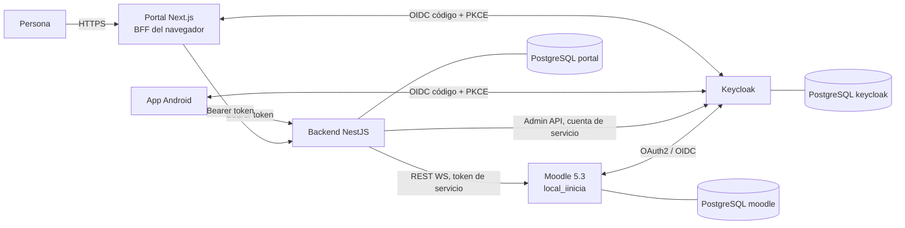

# 01 · Arquitectura

## Componentes

| Componente | Tecnología | Responsabilidad | Carpeta |
|---|---|---|---|
| Portal | Next.js 16, React 19, TypeScript, Tailwind 4 | Sitio institucional, registro, Mi IINICIA, panel de gestión. Actúa como BFF del navegador | `frontend/` |
| Backend | NestJS 11, Node.js 24 | API versionada en 12 módulos funcionales (controlador, servicio y repositorio SQL por módulo), RBAC, auditoría, integración con Moodle y Keycloak. Detalle en [13-refactorizacion-backend.md](13-refactorizacion-backend.md) | `backend/` |
| Base del portal | PostgreSQL 17 | Usuarios, roles, programas, solicitudes, matrículas, contenidos, auditoría | migraciones en `backend/src/db/migrations` |
| Identidad | Keycloak 26.4 (OIDC/OAuth 2.0) | Cuentas, contraseñas, sesiones, MFA, SSO. Tema `iinicia` para la pantalla de acceso y los correos, en español de tú | `infrastructure/keycloak` |
| LMS | Moodle 5.3.1 LTS, PHP 8.4 | Cursos, actividades, calificaciones, progreso | imagen en `infrastructure/moodle` |
| Extensiones Moodle | Plugin `local_iinicia`, tema `theme_iinicia` | Servicios web propios, SSO, identidad visual. Moodle Core no se modifica | `moodle-custom/` |
| App | Kotlin, Jetpack Compose, AppAuth | App de estudiantes | `android/` |
| Correo (DEV) | Mailpit | Captura los correos en desarrollo | `infrastructure/docker-compose.yml` |

## Diagrama

## Principios aplicados

- **Una sola identidad.** Keycloak emite la identidad para el portal, Moodle y la app. Cada persona tiene un UUID interno, un `sub` de OIDC y un ID de Moodle, relacionados en la tabla `users`. El correo es un atributo, no la llave.
- **Moodle es la fuente académica.** Cursos, actividades, calificaciones y progreso viven en Moodle. El portal solo los consulta.
- **Sin acceso directo a bases ajenas.** Cada servicio tiene su propia base y su propio usuario. El backend habla con Moodle solo por servicios web y con Keycloak solo por su API.
- **Ningún secreto en el cliente.** El navegador recibe cookies `httpOnly` cifradas (A256GCM) y la app solo tokens de usuario. El token de servicio de Moodle y los secretos de Keycloak se quedan en el servidor.
- **API-first.** Las capacidades se exponen en `/api/v1`, documentadas con OpenAPI ([api/openapi.json](api/openapi.json)) y con un inventario generado desde el código ([api/inventario-endpoints.md](api/inventario-endpoints.md)). Las pruebas de contrato impiden cambios incompatibles.
- **Módulos con dueño de datos.** Cada módulo del backend escribe solo sus tablas; las operaciones que abarcan varios módulos comparten la transacción (ver documento 13).

## Flujos principales

### Registro y admisión

1. La persona se registra en `/registro`. El backend crea la identidad en Keycloak y el usuario en PostgreSQL con rol `aspirante`, y Keycloak envía el correo «Confirma tu correo» con el diseño IINICIA. Al confirmarlo, el botón «Ir a IINICIA» lleva a Mi IINICIA, que pide iniciar sesión.
2. El aspirante solicita un programa (`POST /me/applications`).
3. Un administrador académico o el coordinador del programa admite la solicitud y, opcionalmente, elige cohorte.
4. En una sola transacción, el rol pasa a `estudiante` y se registran las matrículas de los cursos del programa.
5. La sincronización crea o vincula la cuenta de Moodle (`local_iinicia_upsert_user`), matricula, asigna la cohorte y notifica al estudiante.

Si Moodle no responde, el usuario queda como `pending` y un reintento automático cada 60 s completa la sincronización.

### Acceso unificado (SSO)

- **Portal:** flujo de código OIDC con PKCE. Los tokens se guardan cifrados en cookies y `proxy.ts` los renueva antes de que expiren.
- **Moodle:** el botón "Entrar al Campus" pide al backend un enlace (`/me/campus-link`) que apunta a `local/iinicia/sso.php`. Moodle inicia OAuth2 con Keycloak y, como la sesión ya existe, entra sin pedir contraseña. La cuenta se vincula por `sub` (tabla `auth_oauth2_linked_login`), no por correo.
- **App:** AppAuth con PKCE en el navegador del sistema y `offline_access` para una sesión de hasta 30 días de inactividad. Las actividades se abren en una pestaña personalizada (Custom Tab) que comparte la sesión con Keycloak.

## Decisiones técnicas

| Decisión | Motivo |
|---|---|
| Keycloak como proveedor de identidad | OIDC estándar, MFA, recuperación de contraseña y sesiones centralizadas sin desarrollo propio |
| Plugin `local_iinicia` en lugar de servicios web core | Alta idempotente por UUID, visibilidad calculada para el estudiante y no para la cuenta de servicio, y permisos mínimos (una sola capacidad) |
| PostgreSQL para el CMS | Contenido editable sin código y sin WordPress. Las imágenes se guardan en la base y viajan con el respaldo |
| `proxy.ts` (Next 16) para sesión y redirecciones | Renueva tokens, responde 404 reales y aplica las redirecciones 301 de las URLs antiguas de WordPress |
| Notificaciones por consulta periódica (WorkManager) | Funciona sin proyecto Firebase. FCM se integra sin cambiar la API (tabla `devices`) |
| Moodle 5.3.1 LTS | Versión LTS vigente. Requiere PostgreSQL 17 y PHP 8.3 o superior |

## Modelo de datos (portal)

`users`, `user_roles` (rol con programa opcional para coordinadores), `programs`, `cohorts`, `program_courses`, `applications`, `enrolments`, `content_items`, `media`, `redirects`, `info_requests`, `notifications`, `devices` y `audit_log`. Este último es de solo inserción, protegido por un trigger.
